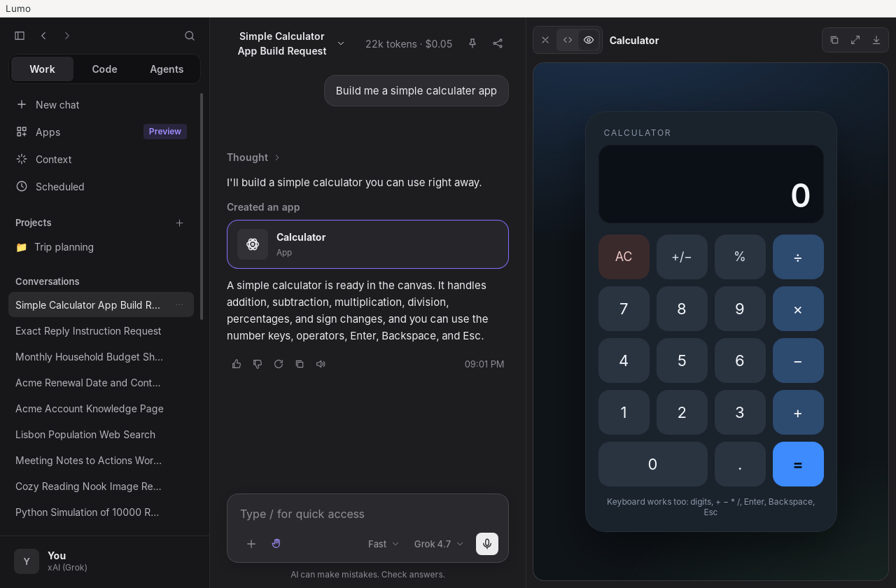
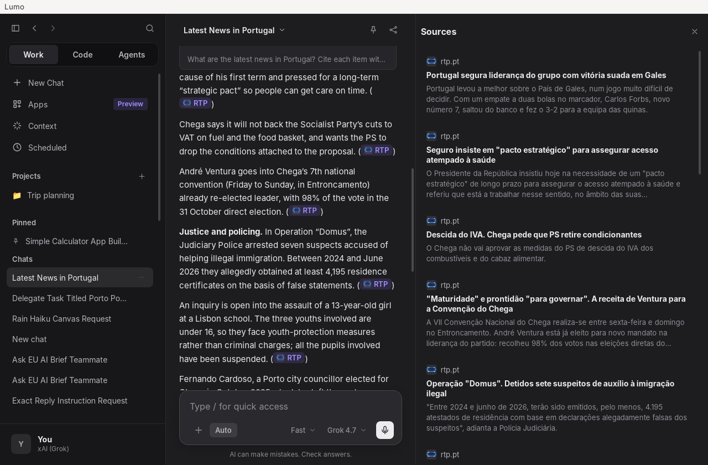
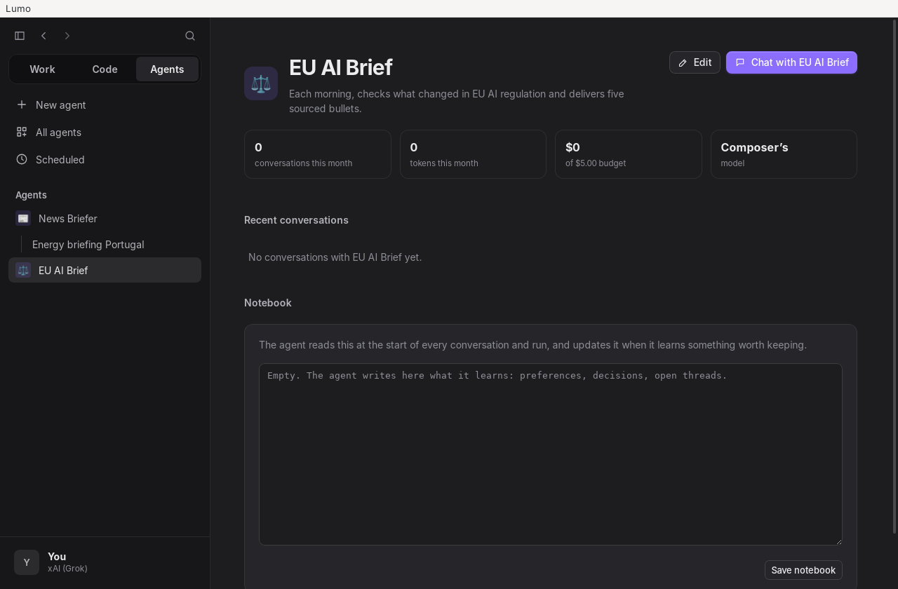

<p align="center">
  
</p>

<h1 align="center">Cortex Desktop</h1>

<p align="center">
  An open-source desktop AI workspace, in the spirit of Mistral Vibe: chat, research, code and agents,<br>
  with any model provider. Built in Rust on <a href="https://rig.rs">rig</a> and <a href="https://tauri.app">Tauri</a>.<br>
  macOS · Windows · Linux · GPL-3.0
</p>

<p align="center">
  
</p>

---

Cortex Desktop (formerly Lumo Desktop) reimplements Mistral Vibe's Work and Code experience as a native, local-first app. Every model call
happens in Rust through rig, so it works with OpenAI, Anthropic, Gemini, Mistral, xAI, DeepSeek, OpenRouter,
Groq, Together, Perplexity, Cohere, Moonshot, Z.ai, local Ollama or llama.cpp, or any OpenAI-compatible
gateway. Conversations, knowledge and settings stay on your computer; API keys live in the OS keychain.

[docs/feature-parity.md](docs/feature-parity.md) compares it with Mistral Vibe screen by screen, item by item
from Vibe's changelog and documentation, and with Open WebUI, LibreChat, LobeHub, Onyx, Osaurus and OpenBot.

## What it does

**Work, Code and Agents**
- **Work**: chat, research and documents, with Fast or Think, a Claude-style mode menu (Auto, Accept edits,
  Plan, Ask; Shift+Tab), steering while a task runs (Enter) or queueing for after (Alt+Enter), Stop,
  suggested follow-ups, `/` commands, prompt `{{variables}}`, per-chat model settings, and LaTeX.
- **Code**: sessions bound to a folder. The model knows the branch, uncommitted files and `AGENTS.md`; Files,
  Changes (unified or split diff), Terminal (background commands) and Debug panels; commit and open a pull
  request.
- **Agents**: a workforce of agents drafted from one sentence, each with instructions, model and backup model,
  a notebook it keeps itself, tool policies (allowed, ask first, blocked), scheduled tasks, a monthly budget,
  and hand-offs between agents.

**Grounded answers**
- Web search with site favicons, hover cards (image, title, description) and a Sources panel.
- Libraries: keyword (BM25) retrieval, plus semantic search with any OpenAI-compatible embedding model
  (Ollama, LM Studio, OpenAI, Mistral), fused by rank; folders mirrored and kept in sync; photos and scans
  read by your model (OCR); cited with numbered footnotes.
- Web search keyless by default, or through SearXNG, Brave Search or Tavily.
- The assistant searches and reads your earlier chats; any chat can be attached to another as context.
- Knowledge: facts and pages the model saves and recalls when relevant; you can edit both.
- Deep research with parallel sub-agents, whose every step you can open.

**Work products**
- Canvases with versions, a Changes view and restore; mini apps that run sandboxed in a side panel with
  tabs; spreadsheets with several sheets (Excel in and out); Mermaid diagrams and Marp slides; a Preview /
  Code switch on all of them.
- Code interpreter (`run_code`: Python, JavaScript, Bash in a bubblewrap sandbox; code blocks in answers have
  Run and Download buttons), image generation, and voice: dictation, read-aloud and a hands-free voice
  conversation with any OpenAI-compatible, ElevenLabs or xAI speech service, or the system voice.

**Context and control**
- Skills (`/` or `@`), Workflows, Projects with shared context, Connectors to any MCP server (tools load on
  demand past 30), OpenAPI tool servers (each operation a tool), Instructions.
- Scheduled tasks on a timer or when new files arrive in a folder, with a calendar of planned and past runs.
- Computer use (off by default): the assistant sees the screen and clicks and types, each action under the
  approval mode.
- A local OpenAI-compatible API (off by default, this computer only, key required) so scripts and other apps
  can use the models set up here.
- Approvals that explain why they ask; hard-to-undo commands always ask; unattended runs cannot change
  anything unless allowed; an optional personal-data filter before cloud models.
- Context engineering: old tool results are cleared, long chats are summarized at 60% of the window, and a
  context view shows what fills it.

**Built to be used for years**
- Search everything ever said (Ctrl+K, which is also a command palette), pinned chats, archive, tags, branches.
- Daily backups, a 30-day trash, damage detection with restore, and an index that keeps a long history fast.
- Import from ChatGPT and Claude; export everything, a chat as Markdown or JSON, or as a single web page.
- Agents export and import as one file with their notebook and skills.
- Drafts stay with their chat across restarts; long pastes become attachments; messages can be deleted.

<p align="center">
  
  
</p>

## Keyboard shortcuts

| Keys | Action |
|---|---|
| Ctrl+K | Command palette and search |
| Ctrl+N | New chat |
| Ctrl+1 … 9 | Open the chats in the sidebar |
| Ctrl+Shift+1 / 2 / 3 | Work / Code / Agents |
| Ctrl+B | Toggle the sidebar |
| Ctrl+, | Settings |
| Shift+Tab | Next mode (Auto, Accept edits, Plan, Ask) |
| Up / Down, Ctrl+R | Earlier prompts, search earlier prompts |
| Ctrl+O | Fold or unfold all activity |
| Enter / Alt+Enter while a task runs | Steer it now / queue the message for after |
| `/` | Commands (/new, /temporary, /model, /voice, /fork, /context, /settings, /export) and skills |

## Providers and keys

Add providers in **Settings → Providers & models**: keys go to the OS keychain, or come from the provider's usual
environment variable (`OPENAI_API_KEY`, `XAI_API_KEY`, …). A base URL points a provider at a proxy or compatible
gateway. Speech-to-text and text-to-speech engines are set separately in **Settings → Audio**.

## How it is built

```
webview/pages/app/   TypeScript UI (no framework), in folders: core, ui, shell, chat, canvas, pages, settings
        ↕  Tauri IPC (generated command list, per-file permissions) and chat://event streams
src-tauri/src/chat/  Rust chat engine on rig, in layers: storage → models, grounding, toolkit → turn, automation → commands
src-tauri/crates/    the AI core that needs no window: agent loop, retrieval, traces, WASM sandbox
```

[docs/architecture.md](docs/architecture.md) maps every folder, the layering rule, where each data file
lives, and the steps for adding a command, a tool, a connector or a setting.
[CONTRIBUTING.md](CONTRIBUTING.md) has the checks to run and the conventions reviews hold to.

## Hosted mode (the original Lumo Desktop)

This project began as Proton's Lumo Desktop, a native shell around the hosted Lumo web app. Build with
the `hosted` Cargo feature (`npm run tauri build -- --features hosted`) to get that app back; the
rest of this section describes it. The native app compiles none of it.

Lumo Desktop wraps the Lumo web app in a native [Tauri](https://tauri.app) shell and gives it access to your
computer and your tools, with your approval:

- **Connectors**: let Lumo read and edit local files, run shell commands, and use Proton Mail, Luminance, and
  any [MCP](https://modelcontextprotocol.io) server, with a catalog of presets such as GitHub, Linear, Figma,
  Grafana, Stripe and PubMed.
- **Approvals**: every tool is set to auto-approve, ask, or disabled. Tools set to ask wait for your answer
  before they run.
- **Quick ask**: a global shortcut opens a search window from anywhere.
- **Scheduled prompts**: run prompts on a schedule.
- **Secure storage**: OAuth tokens, API keys and MCP credentials live in the OS keychain.
- **Browser sign-in**: you sign in with your own browser, so security keys and passkeys work.
- **Automatic updates**: signed updates on every platform.

### Supported platforms

| Platform | Package |
|---|---|
| macOS | Universal (Apple silicon and Intel) `.dmg` |
| Windows | `.msi` and `-setup.exe` installer |
| Linux | `.deb` and `.rpm` (Ubuntu 24.04+, Fedora 40+), AppImage, and a Flatpak for any distribution |

### Architecture

```
        ┌──────────────────────────────┐
        │        Lumo web app          │   loaded remotely from LUMO_URL
        └──────────────────────────────┘
                       ↕  window.LumoConnectors
        ┌──────────────────────────────┐
        │  webview/bridges/connectors  │   TypeScript → src-tauri/dist/
        └──────────────────────────────┘
                       ↕  Tauri IPC: commands + events
        ┌──────────────────────────────┐
        │        src-tauri/src         │   Rust core
        └──────────────────────────────┘
```

- **Lumo web app**: lives in Proton's web clients monorepo and is loaded remotely. Its `desktop-tools.ts`
  consumes the bridge.
- **webview/**: TypeScript bundled by `scripts/build-webview.mjs` into `src-tauri/dist/scripts/`. There are two
  kinds: scripts injected into the remote page (`webview/bridges/`), and scripts for the local pages that
  aren't the web app (`webview/pages/`: `login`, `search`, `settings`). The pages' HTML, CSS and images live in
  `webview/static/` and are copied into `dist/` unchanged.
- **Rust core**: tool registry, connectors, keychain, approval gate, account scoping, updater.
- **IPC boundary**: commands are allowlisted in `src-tauri/permissions/*.toml` and granted in
  `src-tauri/capabilities/default.json`. Rust pushes state back as events (connector auth, tool-approval
  requests). Adding a command takes three edits: the handler, the permission, and the capability.
- **The bridge contract spans two repos**: `webview/bridges/connectors.ts` and the web app's `desktop-tools.ts`
  must agree. The E2E suite builds its stub from a live checkout of the web clients on every run to catch drift.

#### Project layout

```
webview/
├── bridges/                 scripts injected into the remote Lumo page, one bundle each
├── pages/                   scripts for the local pages (login, search, settings, theme)
├── shared/                  Tauri invoke, logger and connector catalog, imported by both
├── types/                   contracts with the web app, and window globals
└── static/                  pages, styles/ and images/ (incl. connector logos), copied to dist/
scripts/                     build-webview.mjs, version and updater-archive scripts
e2e/                         containerised WebDriver suite
src-tauri/
├── src/
│   ├── app.rs               Tauri builder: plugins, IPC handler, startup
│   ├── main_window.rs       main window, its webviews and close-to-tray
│   ├── webview.rs           navigation policy and sign-in page
│   ├── browser_login.rs     session-fork sign-in
│   ├── tray.rs              app menu and tray icon
│   ├── quick_ask/           global-shortcut search window and its handoff
│   ├── settings/            device and per-account settings, settings overlay
│   ├── dialog/              native branded and loading dialogs
│   ├── tools/               registry, connectors, keychain, approvals
│   ├── schedules/           scheduled prompts
│   ├── updater.rs
│   └── lib.rs               LUMO_URL, module tree
├── capabilities/            IPC grants
├── permissions/             command allowlists
├── dist/                    webview build output, gitignored
└── tauri.conf.json
```

#### Sign-in

WKWebView does not dispatch WebAuthn, so security keys and passkeys cannot work inside the webview. Sign-in
therefore happens in the user's own browser: the app starts on a bundled `login.html`, sends the user to
Proton Account, and receives the session back through Proton's session-fork protocol, which the webview
redeems before loading the web app. See `src-tauri/src/browser_login.rs`.

#### Connectors

Connectors are registered at startup into a `ToolRegistry` and exposed to the web app as OpenAI-format tools
named `{connector_id}__{tool_name}`.

| Connector | Notes |
|---|---|
| `filesystem` | Search, read, write and edit within user-granted roots |
| `bash` | Shell execution |
| `browser` | Fetch and read web pages |
| `proton_mail` | Proton Mail through [Proton Mail Bridge](https://proton.me/mail/bridge) |
| `luminance` | Luminance Public API v2, called directly (Luminance has no MCP server) |
| `mcp-{id}` | Any MCP server. The catalog in `webview/shared/connector-catalog.ts` pre-configures many remote servers; some are experimental and hidden behind a feature flag |
| `mcp-zendesk` | Community [`@fruggr/zendesk-mcp-server`](https://github.com/fruggr/zendesk-mcp-server) (stdio via `npx`; OAuth on first tool use) |
| `mcp-figma` | [Figma desktop MCP](https://developers.figma.com/docs/figma-mcp-server/local-server-installation/) at `http://127.0.0.1:3845/mcp` (enable it in Figma desktop Dev Mode; remote OAuth is limited to [Figma's MCP catalog](https://www.figma.com/mcp-catalog/)) |
| `echo` | E2E fixture, registered only under `CORTEX_E2E_TESTING` |

Each tool also carries an approval policy (auto-approve, ask, or disable). An `ask` tool suspends execution,
emits a request to the webview, and resolves on the user's answer or a timeout.

## Developing

### Prerequisites

| Tool | Version |
|---|---|
| [Node.js](https://nodejs.org/) | 22 |
| [Rust](https://rustup.rs/) | stable (2021 edition) |

You also need the [Tauri prerequisites](https://tauri.app/start/prerequisites/) for your platform (WebKitGTK
on Linux, WebView2 on Windows).

Optionally, enable the pre-push hook (type check and unit tests):

```bash
git config core.hooksPath .githooks
```

### Running

```bash
npm install
npm run dev
```

The native app does not sign in or contact Proton. On first start, add a provider in **Settings → Providers &
models**.

For the hosted mode, build with the `hosted` feature (`npm run dev -- --features hosted`); it loads the web app from `LUMO_URL` (by default
`https://lumo.proton.dev`, a local checkout of Proton's web clients) and requires a Proton sign-in.

### Dev loop

- Rust changes hot-restart the app.
- TypeScript changes do not: there is no frontend dev server, and esbuild runs once at startup. After editing a
  `.ts` file, rebuild the bundles with `npm run build:webview` and reload the window.
- Changes to injected scripts (`webview/bridges/`) need a restart of `npm run dev`.

## Testing

```bash
npm run typecheck && npm run lint && npm test                           # TypeScript
cargo test --manifest-path src-tauri/Cargo.toml --features test-utils   # Rust unit and integration tests
```

### End-to-end tests

The E2E suite needs a checkout of Proton's web clients as a sibling of this project, or at `CLIENTS_DIR`:

```bash
./e2e/run.sh
```

It runs in a Linux container because WebKitGTK ships a WebDriver. See [`e2e/README.md`](e2e/README.md).

## Building

On macOS, build an ad-hoc signed app with:

```bash
APPLE_SIGNING_IDENTITY="-" npm run build
```

On Linux and Windows, `npm run build` is enough. For a Flatpak, build the `.deb` and run
`scripts/build-flatpak.sh` on it (docs/releasing.md).

Bundles land in `src-tauri/target/<target>/release/bundle/`. The executable is named `cortex-desktop`
(`cortex-desktop.exe` on Windows); the app's displayed name is `Cortex`.

## Config and data storage

| Platform | Config directory |
|---|---|
| macOS | `~/Library/Application Support/io.github.morgadoo.cortex-desktop/` |
| Windows | `%APPDATA%\io.github.morgadoo.cortex-desktop\` |
| Linux | `~/.config/io.github.morgadoo.cortex-desktop/` |

Coming from Lumo Desktop: on first launch, folders named after its identifier `me.proton.lumo-app` (config,
data, cache, logs and webview storage) move to the new name, `lumo.*` interface preferences become `cortex.*`,
and keychain secrets move from the `me.proton.lumo-app` service the first time each is read
(`src-tauri/src/rename_migration.rs`). Data formats keep their original markers (`LUMOREST1`, `LUMOSYNC1`,
`.lumo` sync files), so encrypted and synced data keep loading.

```
settings.json                            shortcut, launch at startup, settings hotkey
accounts/<UserID>/settings.json          filesystem roots, write flag, shell flag
accounts/<UserID>/mcp_servers.json       MCP server definitions
accounts/<UserID>/connector_state.json   enable flags, per-tool approval policies
accounts/<UserID>/mcp_tools/             cached tool lists per MCP server id
```

The native app keeps its data under `chat/` in the same folder:

```
chat/conversations/        one JSON file per conversation (rig's message history, with a format version)
chat/index/                the search index: sidebar rows and searchable text, rebuilt if deleted
chat/backups/<date>/       each conversation as it was before its first change of the day; 30 days
chat/trash/                deleted conversations, restorable for 30 days
chat/canvases/, sandbox/   canvases and mini apps; code-run workspaces
chat/agents/<id>/          each agent's notebook
chat/favicons/, previews/  cached site icons and link previews
chat/*.json                projects, knowledge, agents, tasks, providers, audio and other settings
```

Secrets (provider keys, OAuth tokens, API keys, MCP server credentials) are stored in the OS keychain under the
service `io.github.morgadoo.cortex-desktop`.

### Resetting MCP setup

To wipe **all** MCP setup for one Cortex account, quit Cortex first, then:

1. In **Settings → Connectors**, use **Reset** on each catalog MCP server (or **Remove** on custom ones).
2. Delete or empty `accounts/<UserID>/mcp_servers.json`.
3. Optionally, delete `accounts/<UserID>/mcp_tools/` and trim `connector_state.json` for a clean slate.
4. In your keychain (Keychain Access on macOS), search for `io.github.morgadoo.cortex-desktop` and delete entries whose
   account starts with `connector:<UserID>:mcp-`.

The community Zendesk MCP server also stores its **own** OAuth token on disk, outside Cortex's keychain. After
removing the connector, clear those files if you need a full re-login; see
[fruggr/zendesk-mcp-server `OAUTH_TOKEN_FILE`](https://github.com/fruggr/zendesk-mcp-server/blob/main/docs/configuration.md#oauth_token_file).

### Uninstalling

To remove a local install and its data:

```bash
./src-tauri/scripts/uninstall.sh          # --dry-run to preview, --yes to skip the prompt
```

## Releasing

Release builds, signing and publishing run in Proton's internal CI; see `RELEASING.md` in the internal
repository.

## License

Cortex is licensed under the [GNU General Public License v3.0](LICENSE). It is not affiliated with Mistral AI or
Proton AG; Mistral Vibe is the design reference, and the project began as a fork of Proton's Lumo Desktop.
